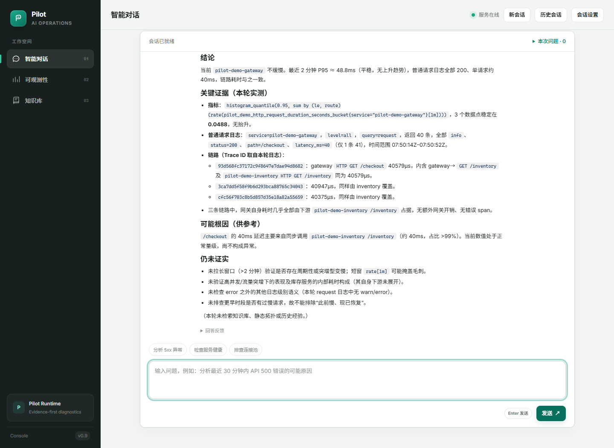
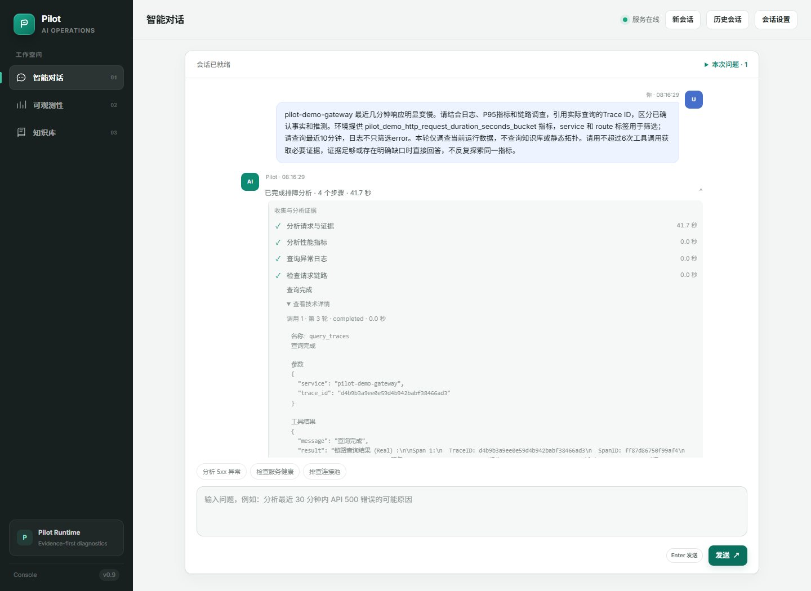
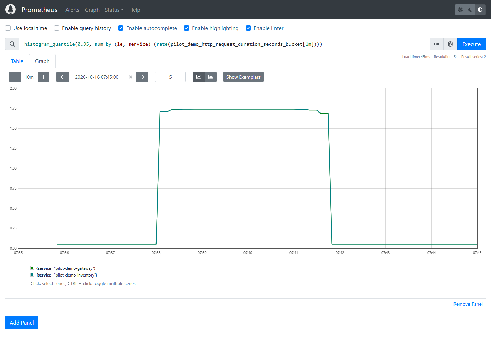
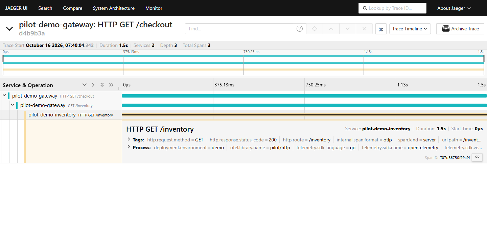

<div align="center">

# Pilot

**让故障排查有迹可循，让解决经验能够复用。**

An AI-powered troubleshooting workspace.

基于 Go 与 Eino ADK 的智能排障工作台。检索日志、指标、调用链和技术指南，将多轮故障排查整理为可审核、可复用的经验。

[功能概览](#features) · [产品演示](#demo) · [快速开始](#quick-start) · [技术细节](#under-the-hood) · [开发文档](#documentation)

<sub>Go · Eino ADK · Elasticsearch · Prometheus · Jaeger · MySQL</sub>

</div>

---

<a id="features"></a>
## What is Pilot?

Pilot 是一个面向开发者的本地排障工作台。

它不只是让模型回答问题。Agent 可以主动检索可观测性数据及技术指南，呈现调查过程；同一会话中的不同故障也能持续跟踪，并在人工审核后沉淀为可复用的排障经验。

### Investigate with evidence

按需查询 Elasticsearch 日志、Prometheus 告警和指标、Jaeger 调用链，并进行跨信号关联。工具调用过程与最终回答分别呈现，便于回看排障依据。

### Search your documentation

上传 Markdown 技术指南。结合关键词与向量检索，补回命中片段所在章节的相关上下文，而不只是返回孤立文本。

### Turn incidents into knowledge

一个会话可以跟踪多个交错 Issue。独立整理 Agent 汇总跨轮证据并生成经验草稿；人工审核发布后，历史经验可以在新会话中检索。

### Stay in control

查看 Agent 执行进度，取消任务，或在 SSE 连接断开后按事件序号续接。原始历史和模型工作上下文分别保存，长会话按容量进行摘要。

<a id="demo"></a>
## Product demo

先看看 Pilot 的实际工作界面。下图展示一次本地演示环境中的排障对话：Agent 调查结束后，以可阅读的形式呈现诊断结果和证据。



<sub>真实本地运行截图 · 演示数据，不是生产事故。</sub>

### From question to evidence

当服务响应变慢时，Pilot 会按需检索日志、指标与调用链。执行步骤可以展开，查看工具调用参数以及关联的 Trace ID。



本次演示使用可重复的“下游 HTTP 接口响应缓慢”场景：真实请求产生观测数据，Agent 自行查询证据，没有获得预设根因。恢复后还可以重新查询当前状态，而不是沿用之前的诊断。

<details>
<summary>查看底层观测证据：Prometheus 趋势与 Jaeger Trace</summary>

本地采样的 P95 约为 **49 ms → 1.74 s → 49 ms**（正常、变慢、恢复），数值来自直方图估算，并非单次请求的精确耗时。



同一慢请求的 Trace ID：`d4b9b3a9ee0e59d4b942babf38466ad3`。Jaeger 显示网关 Server、HTTP Client 和 inventory Server 三个父子 Span；嵌套 Span 耗时不可直接相加。



</details>

[真实截图与验收边界](docs/product-demo.md) · [复现故障演示](docs/observability-demo.md)

<a id="quick-start"></a>
## Quick start

以下以 **PowerShell、本机 Go 服务 + Docker 依赖**为例；macOS / Linux 可使用 `cp` 复制配置并运行同样的 Docker 与 Go 命令。所有命令均在仓库根目录执行。

准备 Go 1.24.10+、Docker Compose v2，以及可用的对话模型和 Embedding 服务。默认配置使用 DashScope 的 OpenAI 兼容接口，分别调用 `qwen-plus` 和 `text-embedding-v4`（1024 维）。

### 1. 准备配置

```powershell
Copy-Item .env.example .env
go mod download
```

编辑本地 `.env`：填写 `DASHSCOPE_API_KEY`，将 `MYSQL_ROOT_PASSWORD` 改为自己的本地密码。默认 Redis 和 ES 不启用密码，其对应变量保持为空；仅填写客户端密码不会为容器自动启用认证。

默认配置为 [config.yaml](manifest/config/config.yaml)。更换模型供应商时，可将它复制为 `manifest/config/config.local.yaml`，通过环境变量引用凭据，并分别设置对话与 Embedding 服务的地址、模型和向量维度。配置优先级为 `-config`、`PILOT_CONFIG`、默认路径；启动前会加载根目录 `.env`。更换 Embedding 维度需要使用兼容的新索引，见[索引迁移说明](docs/RAG_MIGRATION.md)。

### 2. 启动依赖

现有 Compose **固定使用 ARM64**。Apple Silicon / ARM64 环境可直接执行；AMD64 环境请使用下方覆盖配置，或自行确认 Docker 已启用 ARM64 模拟。

```powershell
docker compose --env-file .env -f manifest/docker/docker-compose.yml up -d --wait redis elasticsearch mysql prometheus jaeger grafana
```

<details>
<summary>AMD64 / 常见 Windows、Linux x86-64 环境</summary>

将以下内容保存为 `manifest/docker/docker-compose.local.yml`（已忽略提交）：

```yaml
services:
  redis: {platform: linux/amd64}
  elasticsearch: {platform: linux/amd64}
  mysql: {platform: linux/amd64}
  prometheus: {platform: linux/amd64}
  jaeger: {platform: linux/amd64}
  grafana: {platform: linux/amd64}
```

然后使用这条命令替代上方启动命令；该覆盖配置仅用于本机运行 Go 服务时的六个依赖：

```powershell
docker compose --env-file .env -f manifest/docker/docker-compose.yml -f manifest/docker/docker-compose.local.yml up -d --wait redis elasticsearch mysql prometheus jaeger grafana
```

</details>

### 3. 检查依赖并启动服务

```powershell
go run ./cmd/checkdeps
go run ./cmd -config manifest/config/config.yaml
```

自定义配置需同时传递给依赖检查器（通过 `PILOT_CONFIG`）和服务，避免检查与运行使用不同配置。首次启动会自动迁移 MySQL 表并初始化 ES 索引，无需手动建表。

打开 <http://localhost:8080/>。浏览器会建立设备账号，请固定使用 `localhost` 或 `127.0.0.1` 中的一种地址，以免切换 Cookie 身份。健康检查为 `/api/v1/health/ready`，监控指标为 `/metrics`。

可先问“检查 pilot-api 最近 30 分钟的错误，区分事实和假设”，观察执行过程及流式回答；再上传自己的 Markdown 技术指南测试 RAG。新环境没有预置专业指南或真实故障数据，查询无结果并不表示服务异常。经验审核可从对话侧边面板或知识库页面进入。

完整容器运行使用 Compose 的 `app` profile 和 [config.docker.yaml](manifest/config/config.docker.yaml)。仓库中的 `artifacts/startup` 是被忽略的本地环境，不是首次安装的必要依赖。Compose 含开发用口令、关闭认证的依赖及端口映射，仅用于本地演示。

<a id="under-the-hood"></a>
## Under the hood

首页只简述关键实现。完整设计、源码位置和限制可沿链接继续阅读。

| 主题 | 关键实现 | 深入阅读 |
| --- | --- | --- |
| **Agent execution** | Eino ADK 工具调用、参数约束、调查与最终回答分离 | [主 Agent](internal/ai/agent/full_agent.go) · [实现指南](docs/ADK_EXPERIENCE_GUIDE.md) |
| **Hybrid retrieval** | Markdown 结构切分、BM25 / kNN、RRF 融合及章节补全 | [检索实现](internal/ai/retriever/knowledge_retriever.go) · [阅读指南](docs/MARKDOWN_RAG_GUIDE.md) |
| **Run & context** | SSE 事件回放、请求幂等、工作快照加载、原始问答与快照事务提交、摘要 | [Run 管理](internal/controller/chat_runs.go) · [上下文与事务提交](docs/SESSION_CONTEXT_GUIDE.md) · [对话说明](docs/AGENT_CHAT_UI.md) |
| **Knowledge curation** | 跨轮 Issue 跟踪、后台 Job、人工审核与版本管理 | [知识任务](internal/knowledge/worker.go) · [设计说明](docs/ISSUE_KNOWLEDGE_GUIDE.md) |

Pilot 的两类知识库职责不同：**技术文档库**使用 Elasticsearch BM25 / 向量混合检索；**排障经验库**存放在 MySQL，当前按关键词和服务过滤，仅返回当前账号审核通过且已发布的版本，并未使用向量检索。

### Stack

Go · Gin · Eino ADK · Elasticsearch 8.12 · MySQL · Redis · Prometheus · Jaeger · OpenTelemetry · SSE · Docker Compose

## Testing

```powershell
go test ./...
node --test web/app.test.mjs web/agent-session.test.mjs
```

Go 存储测试使用 SQLite，需要 **`CGO_ENABLED=1` 和 C 编译器**；前端测试需要 Node.js。Git Bash / WSL / macOS / Linux 环境还可运行 `make ci`，检查格式、静态分析、构建、race、前端测试及依赖一致性。现有 GitHub Actions 的步骤见 [ci.yml](.github/workflows/ci.yml)，其覆盖范围不等同于完整 `make ci`。

| 验证范围 | 现有测试入口 |
| --- | --- |
| Markdown 边界、父子入库、混合召回、窗口与预算 | [retriever 测试](internal/ai/retriever)、[工具测试](internal/ai/tools) |
| ADK 调查与回答分离、摘要及上下文保存 | [agent 测试](internal/ai/agent) |
| Run 幂等、SSE 回放、取消与持久化 | [chat_runs_test.go](internal/controller/chat_runs_test.go)、[chat_events_test.go](internal/controller/chat_events_test.go) |
| Issue 归属、增量整理、任务与经验版本 | [knowledge 测试](internal/knowledge) |
| 账号隔离、历史与工作上下文存储 | [security 测试](internal/security)、[memory 测试](internal/memory) |
| 前端会话与交互契约 | `web/app.test.mjs`、`web/agent-session.test.mjs` |

这些机制测试不代表真实模型准确率或检索召回率评估。可选的 [Issue 经验验收脚本](scripts/issue_experience_smoke.py) 使用真实服务、模型和数据库，会写入测试数据并产生模型费用；当前脚本依赖 Python Playwright 及 Edge。历史模型验收未完整覆盖最新版，不能视为当前端到端全部通过。可选 Redis Markdown 样例测试在样例不存在时会跳过。

<a id="documentation"></a>
## Documentation

- [ADK 主链路、上下文与经验库](docs/ADK_EXPERIENCE_GUIDE.md)
- [会话工作快照与原始问答的事务提交](docs/SESSION_CONTEXT_GUIDE.md)
- [Issue 跟踪与知识更新](docs/ISSUE_KNOWLEDGE_GUIDE.md)
- [Markdown 切分与父子检索](docs/MARKDOWN_RAG_GUIDE.md)
- [知识召回与章节补全代码复盘](docs/knowledge-retrieval-flow.md)
- [索引迁移](docs/RAG_MIGRATION.md)
- [对话与经验审核界面](docs/UI_WORKSPACE_GUIDE.md)
- [真实 HTTP 慢下游演示与 Agent 证据验收](docs/observability-demo.md)
- [产品截图、观测证据与演示结果](docs/product-demo.md)

[旧架构说明](docs/LEGACY_ARCHITECTURE.md)、ADK Spike、证据图和早期验收报告属于历史参考。部分旧文档及验证脚本仍描述已移除的多 Agent HTTP 路径，当前路由以 [cmd/main.go](cmd/main.go) 为准。

## Current boundaries

- **事件回放不是推理恢复。** 客户端重连可以继续接收现有 Run 事件；服务进程重启后，未完成执行会标记失败并保留已有内容，不从 ADK 推理中间状态续跑。知识整理后台任务具有独立的补扫和重试机制。
- **设备账号不是完整登录系统。** 使用 HttpOnly 随机 Cookie 标识账号，没有密码登录、跨设备恢复和组织权限；清除 Cookie 后不会自动取回原账号数据。Chat 和经验按账号隔离，技术文档库目前共享。
- **模型输出仍需核实。** Issue 归属与相似判断可能出错，程序校验不等于证明结论真实；提供人工修正和经验审核，主链路没有确定性的最终结论引用审计。
- **输入及预算有边界。** 文件上传仅支持 Markdown；上下文压缩使用保守字符估算，章节窗口和工具输出预算也按字符计算，不等于精确 Token 预算。未实现用户画像或偏好记忆。
- **当前没有自主子 Agent 管理。** 主 Agent 自主选择检索工具，独立整理 Agent 由后台任务调度；旧固定多 Agent 包保留用于历史测试。调用云模型时，相关上下文仍会发送到所配置的供应商。

## 仓库文件约定

`.env`、本地覆盖配置、Cookie、数据库、日志、缓存和 `artifacts/` 不提交；`.dockerignore` 另行排除构建上下文中的敏感文件及本地产物。正式配置模板、部署文件、源码、测试和前端依赖保持可用。忽略规则不清除 Git 历史，也不清理已经产生的镜像或构建缓存。
