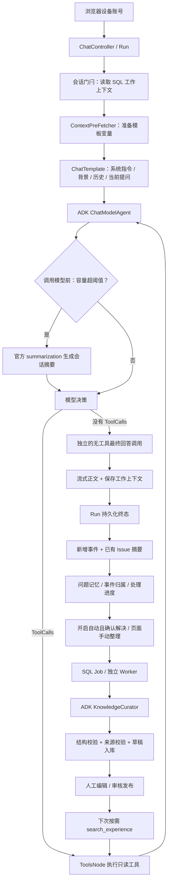

# ADK 主链路与私有经验库

本次迁移把“进行排障”和“沉淀经验”分开：主 Agent 调用观测工具并回答；知识整理 Agent 读取已结束的记录，提出草稿；程序持久化，人审核发布。无需每轮先运行一个意图分类器，也无需点赞后才收录。

## 1. 从一个请求走通

外层 Graph 只组织上下文准备、模板、ADK 三个步骤，内部 Agent Loop 由 ADK 驱动。最终回答依然单独调用同一模型，避免证据收集中的计划文字成为答案；它没有工具绑定，减少“回答到一半又执行工具”的协议歧义。

普通只读工具失败会回填失败观察，允许模型修正参数；取消和超时仍终止请求。模型调用不存在的工具时，官方 `UnknownToolsHandler` 返回明确的 `UNKNOWN_TOOL`，不执行任何实际查询，让模型改用已注册工具。迭代上限仍限制重复错误，不能把恢复机会理解为无限重试或工具成功。

主 Agent 的模型调用配置了官方 `ModelRetryConfig`：短暂网络错误及 HTTP 408、429、500、502、503、504 最多重试 2 次（含首次共 3 次），采用约 300ms、600ms 加随机抖动的退避。取消、任务超时、认证/参数错误、HTTP 402 和明确的 `insufficient_quota` 不重试。重试仅作用于当前模型调用，保留已完成的工具结果，不重新执行整个 Agent。页面通过现有 notice 事件显示重试提示。最终回答的模型调用位于 ADK 外，采用同样的错误分类和次数限制，但仅在尚未输出任何回答文字时重试；已输出部分回答后失败则保留内容并报错，避免拼接重复回答。重试等待仍受原任务 Context 约束。这不提供 Token 断点续传或服务重启后的执行恢复；上游被解析为正常 EOF 的提前结束仍可能无法识别。

迁移后没有调用 `flow/agent/react.NewAgent`。旧固定多 Agent 编排不再在 `cmd/main.go` 构造，其 HTTP 路由与前端入口已下线；包和旧测试保留为历史参考。主 Agent 不具备任意启动新 Agent 的管理功能：当前知识整理 Agent 由任务生命周期调度，适合本次明确的后台整理职责。

## 2. 上下文：框架提供什么，我们提供什么

| 部分 | 职责 |
| --- | --- |
| Eino ADK | 消息和工具循环、工具回填、Middleware 执行顺序、官方摘要生成与替换 |
| Pilot 会话层 | 账号/会话隔离、读取未覆盖的原始历史、跨请求工作上下文持久化 |
| Pilot 压缩策略 | 容量估算、阈值、摘要提示词、保留当前请求、摘要输出预算 |
| Pilot 并发保护 | 同会话串行化、跨进程乐观锁、清理历史后的版本栅栏 |
| Pilot 经验库 | 选择收录时机、草稿/审核/验证、版本发布、私有检索与来源追溯 |

三份数据含义不同：

1. `conversation_history`：界面原始问答，持续写入，不被摘要替换；Redis 只是历史查询缓存。
2. `session_contexts`：模型工作上下文，可包含官方摘要、近期对话、成对的工具调用及结果。按 `(user_id, session_id)` 持久化，下一轮加载它，而非重读最近 12 条覆盖摘要。
3. `experience_*`：跨会话故障案例，经审核的版本才可检索。日志/指标/调用链首先是工具结果，只在经过整理后作为案例来源；不会因为被查询就自动成为长期记忆。

`prepareContext` 先获得会话门闩，再读取 SQL。`HistoryCursor` 指明已读到哪个历史行；`CoveredRunsJSON` 防止工作上下文先保存、控制器历史稍晚落库时又将同一轮重复注入。64 个固定门闩槽限制内存占用，哈希冲突会使少量不同会话串行。SQL 保存使用 Revision CAS，避免另一个进程的旧请求覆盖新上下文；发生冲突时保留最终回答并显示保存失败提示。清理历史会留下更高 Revision 的空上下文，防止正在执行的旧请求把已清理的记忆重新写回来。

摘要在每次模型调用前检查容量，**检查不等于每次重新总结**。只有估算超过阈值才调用摘要模型。估算包含工具 Schema、调用参数和消息 JSON，采用保守字符计数，并非 DeepSeek 精确 tokenizer。当前默认 24000、摘要输出上限 1800 Token。单条超大用户请求或持续输出巨大的工具结果仍可能重复触发，后续可接精确计数与官方 `reduction`；本轮没有实现工具结果转存。

提示词总结多问题会话的来龙去脉、方案淘汰理由、已做操作及未确认事项。Finalize 复用官方摘要包装和内部标记，保留领先 System 消息及当前请求原文，避免官方默认把最多约 30k Token 的旧用户原文再次插回而抵消压缩。原始问答仍保留在 UI 历史中。工具结果会被总结，摘要不应被当作新的真实观测证据。

工作上下文在成功生成最终回答后保存。失败/取消的未完成 Agent 状态不会作为可恢复 ADK Checkpoint 保存；Run 的执行事件和部分答案沿用项目既有持久化。SSE 续接回放事件不等于恢复模型内部推理。

摘要调用也需要独立的模型配置与错误处理：在 DeepSeek 官方端点上复用 `BackgroundOptions` 关闭摘要请求的 thinking，保留 1800 Token 正文预算；主 Agent 的模型配置不受影响。空正文在摘要模型适配层转换为明确错误，再由 Eino summarization 的官方 `RetryConfig` 对空摘要和短暂网络错误最多重试 2 次。取消、任务超时和永久错误不重试；重试耗尽时保留原消息，不用推理内容冒充摘要，也不保存空摘要。

## 3. 经验任务与知识整理 Agent

Run 结束回调创建 SQL 任务，不同步调用整理模型。Worker 每 2 秒领取任务，每 20 秒补查漏掉的终态 Run；启用时间持久化，重启不会丢掉漏扫范围。每次只输入本轮消息和工具结果、已有 Issue 摘要以及有限的未归属事件。开启自动整理时，问题确认解决后自动提炼草稿，新设备默认开启，已有设备保留原设置。用户也可通过页面“整理经验”或“结束排障并整理”按钮直接调用后端接口。主 Agent 只提供经验检索，不创建经验整理任务；聊天中的整理请求引导用户操作页面。

任务唯一键 `(owner_id, run_id)`，关联唯一键 `(owner_id, issue_id, event_id)`。Issue 跟踪先提交并标记 tracked，再逐个生成知识；失败重试不会再次处理已归属的事件或已整理的问题版本。失败最多尝试 3 次，可手动重试。执行超时 2 分钟，租约 3 分钟，领取与提交均校验租约 Token。关闭自动草稿开关不会关闭 Issue 增量跟踪。

入队时固化当前 Run 的提问、回答和公开工具结果，不重读整个 Session。Issue Memory 只保留简短摘要、状态和证据引用。整理时按 Issue 引用取回来源记录，子 Agent 分页读取；大日志沿用公开事件的截断和脱敏规则。后续清理界面历史不会破坏已保存的来源快照。工作会话摘要和 Issue 摘要不同：前者供主 Agent 继续对话，后者隔离交错问题并用于知识整理。

整理 Agent 只有两个只读工具：

- `get_source_record`：本任务绑定快照的概览、分页会话、分页原始工具证据，不能通过模型参数指定别的账号或 Run。
- `search_experience`：当前账号已经发布的历史经验，供比较相似案例。

每次处理一个 Issue，模型返回 CREATE/LINK/ENRICH/NOOP 决策，最多一个候选。程序校验问题、字段、证据 ID、目标账号及 Revision；AI 草稿为未验证，根因声称确认时保守降为假设。模型没有发布和直接写库权限。相关待审核草稿及已发布知识在受控概览中供比较，同一问题已有关联时拒绝再次 CREATE。

同一问题跨 Run 更新同一个 Issue。新增信息可以关联旧知识，或给已有草稿追加待审补充；已发布内容新增待审版本，旧版本仍供检索。矛盾以修订理由及补充文本保留，不自动覆盖原说法。完整设计、边界和代码顺序见 [Issue 与知识更新指南](ISSUE_KNOWLEDGE_GUIDE.md)。

## 4. 状态、版本与检索

| 维度 | 状态 | 含义 |
| --- | --- | --- |
| 审核 | pending / approved / rejected | 人是否接受这份内容 |
| 验证 | unverified / partially_verified / verified | 技术结论/操作有多少验证 |
| 生命周期 | draft / published / archived | 是否对检索开放 |

“审核通过”不会自动把验证状态改为 verified。拒绝一个新修订不会把原发布版归档。发布内容不可原位编辑：创建待审核 v2 时 v1 仍供检索；直到 v2 审核发布才切换 `published_version`。归档需要原因，停止检索，保留版本和来源。编辑请求带 `revision`，陈旧提交返回 409；前端保留用户输入。

`search_experience` 只返回当前账号、已发布、未归档、通过审核的发布版本；当前是 SQL 关键词/服务匹配，每次默认最多 3 条，无向量召回/自动多跳。结果明确带 KB ID、版本、验证状态和来源，主模型被要求把历史经验当线索，重新收集当前观测。

实际检索时写入 `experience_references`，事件带 `knowledge_reference`，前端显示“检索历史经验”。该记录证明曾检索，**不证明模型最终采纳或因果判断正确**。最终提示词要求引用 KB ID/version，但本轮没有对自由文本回答增加强制引用验证器；旧固定链路的 Verifier 不再适用于当前主链路。

## 5. 前端交互与身份

回答下方显示单独整理卡片；人工触发、排队、整理中、失败重试、已生成草稿与无草稿分别显示，不把知识正文混入对话。可稍后处理，在“知识库 → 私有排障经验”查看。

审核抽屉主体独立滚动，底部固定操作。证据只读折叠，内容可编辑，审核备注保存；关闭未保存内容时提供保存后关闭/放弃/继续编辑。所有异步提交禁用重复点击，失败保留表单，加载请求有序号避免旧详情覆盖新选择。历史版本只读，来源跳转优先验证当前账号的 Run；原记录清理时仍可查看证据快照。

后端从 HttpOnly 随机 Cookie 验证设备账号，并把 Owner 放入 context。列表、详情、编辑、任务、检索均按此账号过滤。前端展示的 user_id 是标签，修改请求里的 user_id 无法冒充其他账号。Cookie 原值不存 SQL，只存 SHA-256 摘要。

本地 MySQL 数据存放 Docker 卷。没有实现本地 Markdown 镜像或本地大模型；调用远端模型时仍发送相应内容。没有完整 IAM/跨设备账号迁移。原共享参考文档库保持原作用域，不属于私有经验范围。

## 6. 代码阅读顺序

| 顺序 | 文件 | 先看什么 |
| --- | --- | --- |
| 1 | `cmd/main.go` | 两个 ADK Agent、Worker、工具、Controller 如何装配 |
| 2 | `internal/ai/agent/full_agent.go` | 外层 Graph 和 ADK 工具循环配置 |
| 3 | `internal/ai/agent/session_context.go` | 读取、会话并发门闩、摘要策略、保存 |
| 4 | `internal/memory/session_context.go` | 原始历史游标、已覆盖 Run、Revision CAS |
| 5 | `internal/ai/agent/context_prefetcher.go` | 静态背景/持久历史/当前提问的模板变量 |
| 6 | `internal/ai/agent/answer_stream.go` | 调查事件与最终回答的边界、取消传播 |
| 7 | `internal/knowledge/agent.go` | 子 Agent 提示词、只读工具、结构化候选 |
| 8 | `internal/knowledge/worker.go` | SQL Job、租约、重试、恢复、校验入库 |
| 9 | `internal/knowledge/service.go` | 审核/版本/发布检索及权限边界 |
| 10 | `web/knowledge-manager.js` | 草稿卡、管理中心、抽屉、失败保留输入 |

本次没有沿用 Akmatori 的全局 memory 作用域或文件+数据库双写。借鉴的是专业整理 Agent 与检索只读工具的分工；账号、审核状态和版本生命周期由 Pilot 自己实现。

## 7. 验证

- 全量 Go 测试；真实 SQLite 验证幂等/任务恢复/审核版本/账号隔离/历史清理和上下文栅栏。
- 使用真实 ADK + 本地假模型 HTTP 验证工具结果回填、最终流式回答边界、整理 Agent 读取原始证据并生成候选。
- 官方压缩中间件的阈值、当前请求保留、不会每轮摘要、失败不破坏原记录验证。
- Node 测试验证 SSE 分片、取消/失败终态、历史回放、Markdown、流式批处理。
- 浏览器实测使用当前配置的真实模型，完成排障、异步草稿、未保存关闭提示、编辑、审核发布、刷新与第二账号隔离。
- 故障注入验证保存接口临时失败时编辑内容仍在；修订草稿不影响已发布版本的检索，版本历史保持只读。
- 真实模型在新会话检索并引用发布版 v1，随后发布 v2，查看旧 v1 仍保持原内容。检索请求明确不限定服务；提示词和 Schema 都避免把静态服务名当作默认过滤范围。

当前浏览器脚本：`scripts/issue_experience_smoke.py`。验证交错问题、增量记忆、自动草稿、抽屉审核、接口失败、跨会话发布版检索、刷新和移动端。非敏感结果位于 `artifacts/issue-experience-smoke/result.json`；浏览器状态文件包含凭据，不应公开。原 `experience_smoke.py` 和 followup 脚本是迁移前验收记录。

Windows 缺 C 编译器时 SQLite 测试需在带 GCC 的 Go 容器执行。当前依赖的老 SQLite 驱动在 musl 可能需要测试环境兼容宏：`CGO_CFLAGS=-O2 -g -Dpread64=pread -Dpwrite64=pwrite -Doff64_t=off_t`。这是测试构建条件，不修改生产 MySQL 驱动。
