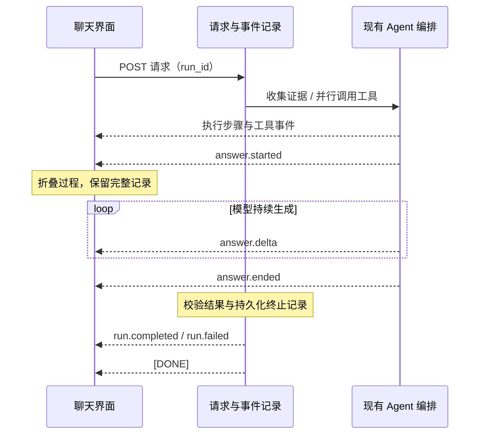

# Agent 聊天交互与事件协议

本次改造保持现有 Eino ReAct、Planner / Evidence / Knowledge / Synthesis 编排、证据校验和并行工具执行。变化集中在输出阶段、事件传输、执行记录及前端呈现。

## 原因与调整

旧 `liveReactStream` 转发每一轮模型的 Content。模型可以先输出说明，再发出工具调用，因此首个正文或最后一个工具完成都不能证明最终回答已开始。前端把这些文本全部累加到一个回答，执行面板直到任务结束才折叠；工具按回调到达顺序追加，历史则只保存正文。

统一事件协议通过后端声明阶段。普通 Chat 的流先使用原 ReAct 收集证据，捕获最后一轮的真实消息与工具结果，再使用原始、未绑定工具的模型生成最终回答。这会增加一次模型调用；没有按内容或关键词猜测阶段，也没有将完整回答缓存后模拟打字。旧的混合文本流包装与旧 SSE 处理分支已删除。

多 Agent 的阶段本来就明确：分支执行结束后进入综合器。流式综合器直接读取模型 Stream 并发送增量，保留原有证据校验。若最终校验拒绝诊断，使用显式 replace 事件显示原有确定性证据摘要，提示校验失败，任务不会显示成功。确定性摘要直接返回，不模拟模型流。

## 统一事件传输

`POST /api/v1/chat/stream` 始终使用任务事件协议，不需要版本或进度开关。`POST /api/v1/chat/multi-agent`、`/multi-agent/resume` 使用 `include_progress: true` 选择流式响应，否则返回同步 JSON。客户端可传 UUID `run_id`，未传时由后端生成；审批恢复关联 `parent_run_id`。`event_version` 已从请求和前端移除，旧文本 SSE 协议不再支持，旧客户端需要按下面的事件结构解析。同步 `/chat` 与同步多 Agent 的业务契约保留。

每个 SSE 块的名称为 `agent`，`id` 为 `run_id:sequence`。JSON 包含 `run_id`、严格递增的 `sequence`、`kind`、`status` 和时间戳。

| kind | status | 用途 |
| --- | --- | --- |
| run | executing | 整轮开始或再次进入执行 |
| model / role / tool | running / completed / failed / skipped | 过程记录，包含唯一调用 ID、轮次和逻辑组 |
| answer | started | 明确进入最终回答阶段，先折叠过程层 |
| answer | delta | 仅追加最终回答 text |
| answer | ended | 回答流正常结束；此时尚不代表任务完成 |
| answer | replace | 证据校验或确定性降级后的明确结果修正 |
| result | 工作流状态 | 结构化结果元数据及审批信息，不追加到正文 |
| notice | warning | 可见的异常说明，独立于回答正文 |
| run | completed / failed / cancelled / interrupted / rejected / processing | 整轮终止或审批特殊状态 |

前端 `agent-session.js` 按序号排序、去重和缓存暂时乱序的事件；失败和取消后忽略迟到事件。缺少 answer.started 的增量、未结束回答时的 completed 都被视为协议错误。再次进入 executing 会保留已经生成的回答。

`progress.js` 只负责过程呈现：稳定逻辑排序、工具组、调用状态与两级详情。同一逻辑组中同类工具的调用记录归在一个步骤内，失败及后续尝试均保留。模型名称、参数、原始结果、错误与调用轮次默认隐藏。发布前对参数和结果做脱敏，展示时使用 textContent；不发布模型私有推理或提示词。

`agent-chat.js` 负责传输和历史；最终 Markdown 继续使用已有逐帧批处理，仅更新回答节点。状态、过程和正文拥有独立的数据结构及 DOM 区域。用户向上阅读时保留滚动位置。

工具完成事件同时保留完整、脱敏的 `result` 与简短预览；技术详情优先显示完整结果，历史也保存该结果。这里的完整结果指工具实际返回的数据，仍受工具自身的查询条数及时间窗口约束，不会将模型私有推理作为工具结果发布。

## 断线、取消与历史

- `GET /api/v1/chat/runs/:run_id/events?user_id=...&session_id=...&after=N` 续接已有任务，从 N 后重放；不会重新调用 Agent。
- `POST /api/v1/chat/runs/:run_id/cancel?user_id=...&session_id=...` 取消后台任务，并保存取消状态。HTTP 断开自身不会取消任务。
- `GET /api/v1/chat/runs?user_id=...&session_id=...` 返回独立的执行轨迹、回答和终止状态。
- 新增 `agent_runs` 表，活跃任务每秒保存检查点，完成时先持久化终止记录再公布 completed。长期对话仍保存最终回答，并在原有 Metadata 中关联 run_id，供前端避免重复历史消息。
- 刷新保留用户和会话 ID；未结束任务可重新接入。新历史的过程默认折叠，展开不会执行工具。旧历史没有执行轨迹，按原正文保留，不猜测或伪造步骤。
- 网络续接最多自动尝试三次；持续断网后保留页面内容，可刷新继续接入或读取历史。服务进程重启后，不自动复跑中断的 Agent；已有检查点被标记为中断，已完成记录继续可回放。
- 清除历史同时清除执行记录，并阻止被取消的后台任务重新写回已删除会话。

## 验证

- Node 测试覆盖阶段边界、首块、重复 / 乱序事件、失败 / 取消、重入执行、审批、历史重建、UTF-8 分片、Markdown 与逐帧批处理。
- Go 测试使用真实 OpenAI 兼容 HTTP 适配器，验证最终首块在模型 EOF 前送达、保留工具证据、隔离过程文本；请求测试验证断线 / 重复 POST 不会再次执行、取消和失败保留已接收回答。数据库测试验证更新、所有权、历史关联与删除。
- 相关 Go 包通过竞态检查；SQLite 测试在启用 CGO 的隔离 Linux 容器中运行。
- 桌面 1440px 与手机 390px 浏览器检查覆盖并行组、失败与恢复、两级详情、明确阶段折叠、增量代码块 / 表格、两个阶段取消、断线续接、审批恢复及历史回放。
- 真实 DeepSeek 请求验证普通 Chat 和多 Agent 的最终回答均持续流式生成；执行记录与最终正文分别写入 MySQL，并验证按序号重放不重复回答。
