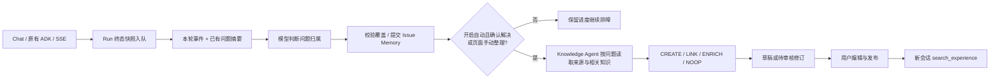

# 从交错排障到跨会话经验

## 设计动机

旧实现按每次 Run 生成新案例，同一个问题跨多轮容易重复建草稿，也容易把多个问题混在一起。当前新增 Issue 作为归属与增量记忆的单位；知识仍然是独立实体，Session 和 Run 只是来源。没有新增微服务、消息队列、登录流程或向量数据库。

## 模型与程序的分工

| 工作 | 模型 | 程序 |
| --- | --- | --- |
| 问题归属 | 将新增内容关联现有问题，识别新问题，允许多重归属及暂时无法归属 | 分配正式 ID；校验引用存在、每个输入事件均被处理；原子保存 |
| Issue 摘要 | 更新现象、事实/假设、已做/建议、方案变化和未完成项 | 限制长度，保存 Revision / LastRunID，不用摘要替换原证据 |
| 状态 | 判断排查中、尚未解决、明确解决 | 首版自动 resolved 必须有用户原文确认；普通工具调用成功不视作修复成功 |
| 经验更新 | 比较环境、症状、根因与新增内容，提出四种决策 | 校验目标账号、Revision、证据引用；同问题已有关联不能重复 CREATE |
| 审核与发布 | 不拥有发布权限 | 人工审核、验证状态独立、版本保留、发布指针、乐观锁 |

界面允许人工更新状态及解决依据。仅有机器观测、没有明确用户确认时，首版不会自动认定解决；用户仍可主动整理未解决案例。此策略优先避免把建议写成已验证修复。

## 增量与恢复

1. 主请求只持久化终态并入队，知识模型不阻塞 SSE。
2. 当前 Run 的提问、回答与公开工具结果固化在 Job 快照。跟踪阶段不加载整个 Session。
3. 加载已有 Issue 的有限摘要，以及最多 100 个未归属事件的预览。未归属事件按最近处理时间轮换，未被此次加载的事件仍保留。
4. 模型输出问题及事件归属。事件 ID 分别为 `run_id:user`、`run_id:assistant`、`run_id:sequence`。一个事件可关联多个问题，无法归属时显式暂存。
5. 在同一事务内更新会话 Revision、Issue 摘要、事件关联和 Job.tracked。失败不提前推进进度。较晚 Run 等待更早 Run 完成跟踪，漏掉的结束回调由持久化启用时间范围内的补扫恢复。
6. 知识阶段按 Issue 读取相关原始来源，每个问题的决策及 OrganizedRevision 独立事务提交。某个问题提炼失败，其他已完成问题保留；重试不重复处理成功阶段。
7. 租约与提交 Token 防止过期 Worker 写入。任务最多自动重试三次，失败可以手动重试；较早跟踪任务永久失败时，后续同会话跟踪等待修复，避免静默跳过。

主 Agent 只检索经验，不发起整理。手动入口是页面“整理经验”或“结束排障并整理”按钮，直接调用绑定当前账号、当前会话的后端接口，为已结束的 Run 排队。自动入口是在 Run 结束后的后台问题跟踪中，检查自动整理开关、解决状态和未整理版本。两种入口共用按 Issue 聚合跨 Run 来源的 Worker，生成的内容仍需人工审核发布。

整理子 Agent 通过 `get_source_record` 分页读来源，必要时检索经验，最后调用 `submit_knowledge` 提交结构化决策。提交工具校验字段和引用，采用 ADK ReturnDirectly 结束本轮；它不写数据库，也没有审核或发布权限。知识服务仍在事务内再次校验目标版本与问题版本，避免模型生成期间的人工修改被覆盖。候选的枚举约束也出现在工具 schema 中，避免模型把说明文字误当成字段值。

提交决策或兼容 JSON 输出未通过校验时，最多追加一次无工具的模型纠正调用，输入为原提案、具体错误和合法引用清单；纠正结果再次走同一套校验，仍失败则由持久化任务记录错误。不会静默删掉错误引用或绕过校验。用户报告可以成为案例描述，消息 ID 不冒充工具观测证据；没有采集到数据也不能作为用户说法错误的反证。

子 Agent 复用 Eino 官方 summarization。原始工具轨迹被作为待摘要资料，而非让摘要模型继续执行的指令；压缩后保留输出协议和程序记录的分页位置，避免从头重复读。相关知识详情不会重复携带历史原始工具结果。后台短任务使用同一 Flash 模型的非思考模式；主排障 Agent 的模型设置保持原样。供应商的模式参数见 [DeepSeek 官方接口文档](https://api-docs.deepseek.com/api/create-chat-completion/)。这是输出预算与执行稳定性的配置，不是将记忆交给框架自动落库。

关闭会话不表示所有问题均解决。“结束排障并整理”和新会话切换会检查已有终态 Run，整理尚有新增内容的问题；服务器没有猜测用户什么时候关闭了浏览器。页面关闭不取消已排队任务。

## 知识更新

- CREATE：新的独立案例。
- LINK：新案例与已有经验一致，无实质新内容，增加来源关联。
- ENRICH：追加待审补充或差异。已有待审草稿保留人工编辑并追加提案；已发布内容创建待审新版本。旧发布版继续检索。
- NOOP：没有复用价值或没有新内容，仍记下已处理的问题版本。

检索给整理 Agent 的候选包含相关草稿与已发布知识；同 Issue 已关联的条目额外保证进入比较范围。主 Agent 的检索只返回审核通过的发布版。采用 SQL 关键词、服务过滤及基础相关性排序，默认返回最多三条，不把全部知识库塞进上下文。

修订采用保守的“原内容 + 标明的新增提案”，方便人检查不同说法，避免模型直接覆盖人工内容。没有实现自动三方合并或语义一致性证明；审核者需要编辑成最终清晰版本。相似检索与模型决策也不能保证所有语义重复都会被发现。

## 代码阅读顺序

| 顺序 | 文件 | 核心问题 |
| --- | --- | --- |
| 1 | `cmd/main.go` | 主 Agent、整理子 Agent、工具、Worker 如何装配 |
| 2 | `internal/knowledge/worker.go` | 入队、按先后领取、租约、重试、恢复 |
| 3 | `internal/knowledge/issue_worker.go` | 跟踪与知识两阶段、按问题来源、决策提交 |
| 4 | `internal/knowledge/issues.go` | Issue Memory、事件覆盖、归属、版本栅栏 |
| 5 | `internal/knowledge/issue_agent.go` | 增量问题跟踪提示词、四种知识决策协议 |
| 6 | `internal/knowledge/agent.go` | ADK 子 Agent、来源分页、检索 |
| 7 | `internal/knowledge/issue_edits.go` | 人工合并、拆分、移动与未归属事件修正 |
| 8 | `internal/knowledge/service.go` | 审核、版本、发布检索 |
| 9 | `web/issue-manager.js` / `web/knowledge-manager.js` | 问题列表与审核抽屉 |

## 使用与验收

在当前会话依次讨论 MySQL 超时、Redis 故障、再回到同一个 MySQL 超时。展开“本次问题”观察 ID 是否复用、摘要与工具引用是否分别保存。确认解决或点击“整理会话经验”；草稿生成后查看抽屉、编辑并发布，新会话通过 search_experience 查找它。

程序验收：`internal/knowledge/issues_test.go` 覆盖交错归属、增量来源、LINK 与修订、失败后不重复跟踪、重启补扫、人工修正、状态与事件覆盖、漏钩子下的先后顺序。既有存储、权限、SSE 和 ADK 测试仍保留。

`internal/knowledge/agent_test.go` 验证真实 ADK 工具循环在结构化提交后停止；`summary_test.go` 验证官方摘要组件不会继续旧工具任务、重新塞回完整历史或丢失读取位置。

真实浏览器验收：`scripts/issue_experience_smoke.py` 使用配置的模型、实际 MySQL 和现有页面，以明确标注的用户提供测试案例验证完整流程；不声称这些案例是当前平台的生产事故。结果与截图在忽略提交的 `artifacts/issue-experience-smoke/`，浏览器状态含凭据，不应分享。

当前验证记录（2026-10-11）：全仓库 Go 测试通过，knowledge/controller/agent/memory/security 的 race 检查通过，前端 26 项测试通过。真实 Flash 测试已经验证多轮问题识别和草稿生成，并发现、修复压缩后重复读取和无关触发轮次污染问题。之后供应商返回 `402 Insufficient Balance`，最新版的完整 A–E 模型验收尚未完成，不能把早期成功记录视作最新版全部通过。恢复额度后可执行上述脚本继续验收。

`scripts/issue_ui_smoke.py` 复用隔离测试账号及已有真实记录，仅验证问题修正、抽屉编辑、保存失败、发布版本与移动布局，不调用模型、不使用模拟知识接口。它是独立的 UI/持久化回归，不能替代完整模型验收。

该 UI 回归已通过：真实接口改名、拆分/合并、刷新后恢复、账号隔离、保存失败保留编辑、成功保存并发布、旧版本不可编辑，以及桌面/390px 手机布局无横向溢出。结果位于 `artifacts/issue-experience-smoke/ui-result.json`；截图包含 `issues-current-*` 与 `review-current-*`。

## 目前边界

- 同一 Session 默认最多 64 个活动 Issue，增量输入预算 96000 字符；超出后任务报错而不静默丢记录，需要缩小材料或拆分会话。
- 知识来源加载最多最近 100 项关联记录，可分页给模型读取；更早原始记录仍在快照中，但当前来源工具不支持无限回溯。公开工具结果可能截断/脱敏，不是供应商完整内部轨迹。
- 暂时无法归属的事件保留并轮换重试；模型仍可能错分，提供人工修正。首版没有独立图谱或全自动知识演化。
- 合并/拆分修正 Issue，不自动修改已发布知识；重新整理后形成待审更新。历史版本保留，不做无审核覆盖。
- 现有设备账号隔离继续复用，无新增登录流程。跨 Session 复用通过知识关联，不将不同会话的原始 Issue 自动合并。
- 向量经验召回、故障模式归纳、用户偏好与完整 Agent Checkpoint 恢复未纳入本次。
