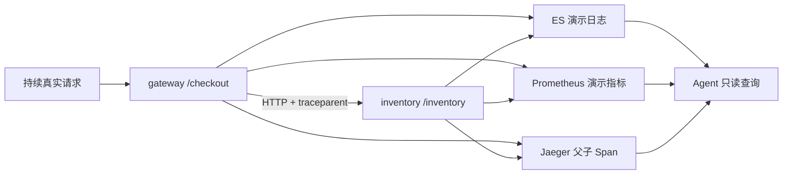

# 真实 HTTP 慢下游演示

这是可重复的本地故障注入，不是生产事故。网关真实请求下游；日志、计数、直方图和 Span 由请求自然产生。不使用 `seedlogs`，不预置根因文档或向 Agent 注入延迟开关状态。



## 运行边界

| 对象 | 独立位置 |
| --- | --- |
| 演示控制台 | `http://localhost:18080` |
| 网关 / 下游 | `:18091/checkout` / `:18092/inventory` |
| MySQL | `pilot_demo`，启动时创建，不清理原 `pilot` |
| Redis | DB 1，账号和会话仍有自己的键，不执行 FLUSH |
| ES 运行日志 | `pilot_demo_logs` |
| 技术文档索引 | `pilot_demo_knowledge_<当前向量维度>`，不导入标准答案 |
| Prometheus | `job="pilot-slow-demo"`，`pilot_demo_http_*`，`service` 区分两个服务 |
| Jaeger | `pilot-demo-gateway`、`pilot-demo-inventory` |
| 本地配置 / 请求记录 / 验收证据 | 忽略提交的 `artifacts/observability-demo/` |

演示和普通 Pilot 复用现有基础设施；独立数据库、索引和指标名前缀避免修改日常数据。Prometheus 与 Jaeger 仍是共享服务，这不是观测数据的权限隔离。不要把 `trace_id` 或每次执行的随机 ID 放入指标标签。

## 启动

需要已运行的 Docker 依赖、Go、Python 3（仅标准库），以及可用的模型和 Embedding。脚本不安装依赖、不下载模型、不修改 `.env`。数据库用户需要有创建 `pilot_demo` 的权限。

在仓库根目录运行，明确使用已经可用的本地配置：

```powershell
powershell -ExecutionPolicy Bypass -File scripts/demo-slow-downstream.ps1 -Action start -Config artifacts/startup/config.deepseek.yaml
```

其他机器传入自己的配置路径；未指定时优先使用上述本地文件，否则使用 `manifest/config/config.yaml`。程序从原 YAML 复制配置并保留 `${ENV_NAME}` 引用，不把展开的密钥输出到终端。原文件不改动，生成配置只写入忽略提交的目录。

启动脚本编译演示程序和独立 Pilot，检查端口占用，启动两个业务进程、持续发压进程及控制台，验证现有 Prometheus 容器的配置并通过 HUP 重载抓取。容器名默认 `pilot-prometheus`，抓取目标采用 Docker Desktop 的 `host.docker.internal`。自定义容器名或 Linux 部署需要对应调整脚本 / 抓取地址。

**使用独立浏览器配置或隐私窗口打开控制台，并关闭会话设置中的自动整理。** Cookie 不按端口隔离；不要用日常 Pilot 的同一浏览器配置访问两个数据库。脚本的 `agent` 验收使用自己的 Cookie 文件并自动关闭自动整理。

## 重复触发与恢复

```powershell
# 每阶段默认持续 120 秒，最多约 2 RPS、4 个在途请求。
powershell -ExecutionPolicy Bypass -File scripts/demo-slow-downstream.ps1 -Action baseline
powershell -ExecutionPolicy Bypass -File scripts/demo-slow-downstream.ps1 -Action verify

powershell -ExecutionPolicy Bypass -File scripts/demo-slow-downstream.ps1 -Action slow
powershell -ExecutionPolicy Bypass -File scripts/demo-slow-downstream.ps1 -Action verify
# 此时在页面提问或运行下方 Agent 验收。

powershell -ExecutionPolicy Bypass -File scripts/demo-slow-downstream.ps1 -Action recover
powershell -ExecutionPolicy Bypass -File scripts/demo-slow-downstream.ps1 -Action verify
```

基线约 40ms，下游变慢阶段等待约 1500ms，恢复后回到 40ms。网关超时 3 秒，首版正常情况下始终返回 200，慢请求产生 warn 日志。延迟等待响应请求取消；控制端点只接受 TCP loopback 来源、有限延迟和有限 TTL，最长 15 分钟后自动回到基线。控制端点注册在观测中间件之前，不产生日志、指标或 Span，避免把开关调用变成 Agent 的答案提示。Agent 没有控制工具。

发压在 `start` 后持续运行，阶段命令只切换下游行为并测量指定时间，结束后仍继续产生真实请求，便于录制和 Agent 调查。各阶段从请求记录中按真实请求开始时间提取样本，不覆盖旧记录。`-Seconds` 可以调整测量时间；验收包含 P95 趋势，需要多个抓取样本，推荐至少两分钟 / 阶段。Prometheus 每 15 秒抓取，Agent 范围查询步长为 60 秒。

同一时刻只执行一条控制脚本命令，页面调查可以并行。发压持续到 `stop`；延迟开关在 15 分钟后自动恢复，但发压不自动停止。

全流程自动执行（包括真实模型调用及费用）：

```powershell
powershell -ExecutionPolicy Bypass -File scripts/demo-slow-downstream.ps1 -Action cycle -Agent
```

也可在完成变慢阶段后单独执行：

```powershell
powershell -ExecutionPolicy Bypass -File scripts/demo-slow-downstream.ps1 -Action agent
```

`verify` 轮询 ES 日志、Jaeger 完整的三段 Span 与父子关系、Prometheus 抓取和阶段结束后的业务计数，并检查当前 P95 与阶段相符。`agent` 消费真实 SSE，检查三个工具成功执行、指标非空、Trace ID 来自本阶段先前返回的网关日志、最终回答引用该 ID，并保存工具结果。它不证明每一句自然语言判断都正确，仍需人工核对耗时、时间范围和因果措辞；失败时保留真实失败，不用固定回答替换。

每次 `agent` 使用独立新会话，要求本轮重新查询三种信号，避免模型直接复用历史 Trace。报告只有全部检查通过才标为 `accepted=true`。页面手动录制可以在同一会话追问恢复，自动验收与手动录制的会话不混用。

真实验收观察到模型仍可能反复查询相同指标或日志。“不超过 6 次”和“500 字以内”属于提示要求，当前没有对应的硬性次数 / 字数门禁；证据验收通过也不代表执行次数或表述长度一定适合展示。当前交付为[静态截图及证据说明](product-demo.md)，保留真实工具参数、观测结果及输出限制。

## 图表与证据

网关 P95（秒）：

```promql
histogram_quantile(0.95, sum by (le) (
  rate(pilot_demo_http_request_duration_seconds_bucket{
    service="pilot-demo-gateway",route="/checkout"
  }[1m])
))
```

下游使用 `service="pilot-demo-inventory",route="/inventory"` 单独查询。一次只选择一个服务，避免当前指标工具把多个序列混在一起。直方图 P95 为桶内估算，不应要求恰好等于 1.500 秒。

**短场景使用 `rate[1m]` 统计口径。** 如果模型改用 `[5m]`，前次慢请求会继续留在分位数窗口中，两分钟的基线 / 恢复可能仍显示高 P95，不能据此声称没有基线或恢复失败。自动验收的问题会明确统计口径；它是指标定义，不是根因提示。

日志包含真实 `timestamp/service/trace_id` 及测量耗时；通过日志中的 Trace ID 到 Jaeger 查看网关 Server → Client → 下游 Server。嵌套 Span 的时间不能相加。当前链路工具不展示 Tags / Span Logs，日志工具也会丢弃任意 `fields`；本场景所需的服务、操作、耗时及 Trace ID 已位于其实际返回字段中。

当前 `correlate_signals` 读取告警、error 日志和指标，不读取 Trace；200 慢请求产生的是 warn，不以该工具是否形成假设作为成功条件。`get_service_topology` 返回 Pilot 的配置依赖，也不能充当这两个业务服务的真实拓扑。当前演示无需告警 firing，避免依赖旧全局延迟规则的等待窗口。

## 演示问题

先积累基线和慢请求，再开始调查。输入只包含症状与指标契约，不透露开关参数：

> pilot-demo-gateway 最近几分钟响应明显变慢。请结合日志、指标和链路调查，引用实际查询的 Trace ID，区分事实与推测。环境提供 pilot_demo_http_request_duration_seconds_bucket，service 和 route 标签用于筛选，日志不只筛选 error。

需要控制调查范围时，可以再要求“只调查当前运行数据，不查知识库或静态拓扑，用不超过 6 次工具调用获取必要证据，证据足够后直接回答”。这是调查范围与预算限制，不包含预设根因；Agent 是否按预算行动仍需要检查真实事件。

也可要求“P95 使用 rate[1m]，回答控制在 500 字以内，保留实际 Trace ID 和数据缺口”，便于阅读和截图。

> 从刚才的日志里选一个慢请求，展开对应链路，说明时间主要花在哪一段。

恢复、生成足够新请求后：

> 请重新查询最近两分钟的指标和新请求日志，判断是否仍然缓慢，并引用新的 Trace ID。

观测可以支持“耗时集中在 inventory 处理 / 调用阶段”；不能据此断言数据库慢、CPU 饱和或网络拥塞。不要把执行控制脚本的记录导入知识库或对话，录制素材应注明本地故障注入。

## 停止与保留

```powershell
powershell -ExecutionPolicy Bypass -File scripts/demo-slow-downstream.ps1 -Action stop
```

仅停止状态文件记录且可验证可执行文件路径的演示进程，不停止普通 Pilot、不停止中间件、不删除数据库、索引或卷。Windows 使用终止进程，停止前先完成证据验收，尚未导出的最后几条观测可能未刷新。再次 `start` 后可重新运行阶段。

关闭自动整理仍会保留 Issue 跟踪任务，记录只进入独立 `pilot_demo` 数据库。不要手动把演示经验发布到日常账号。Cookie、运行配置、工具事件和原始运行截图保留在忽略目录；经检查的四张公开截图位于 `docs/images/demo/`，见[素材说明](product-demo.md)。
