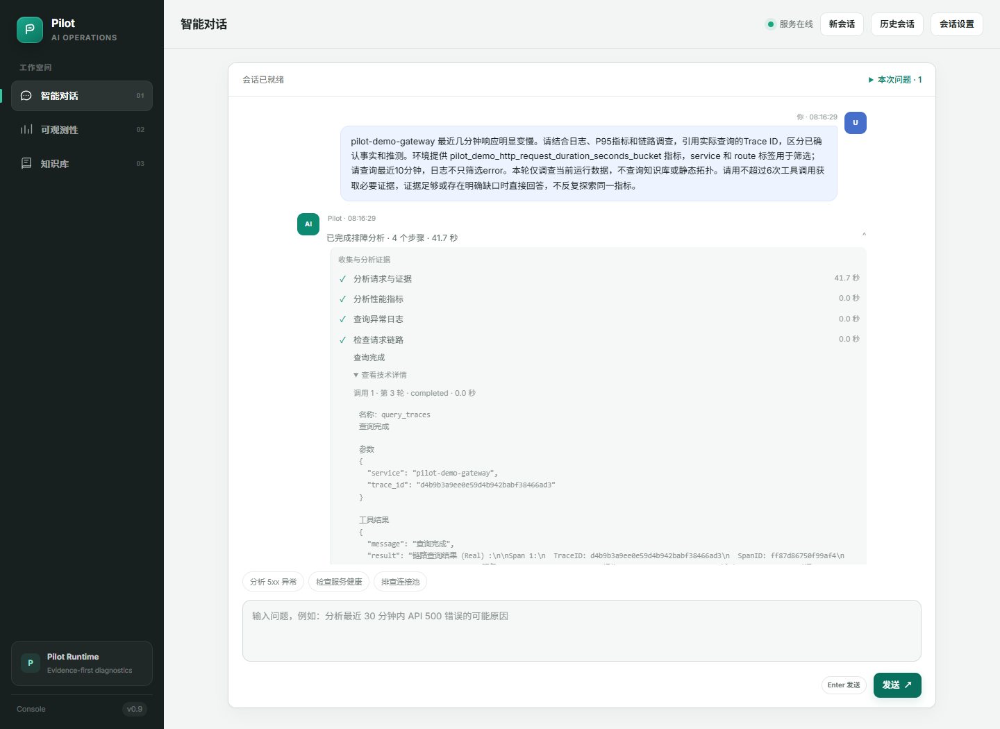
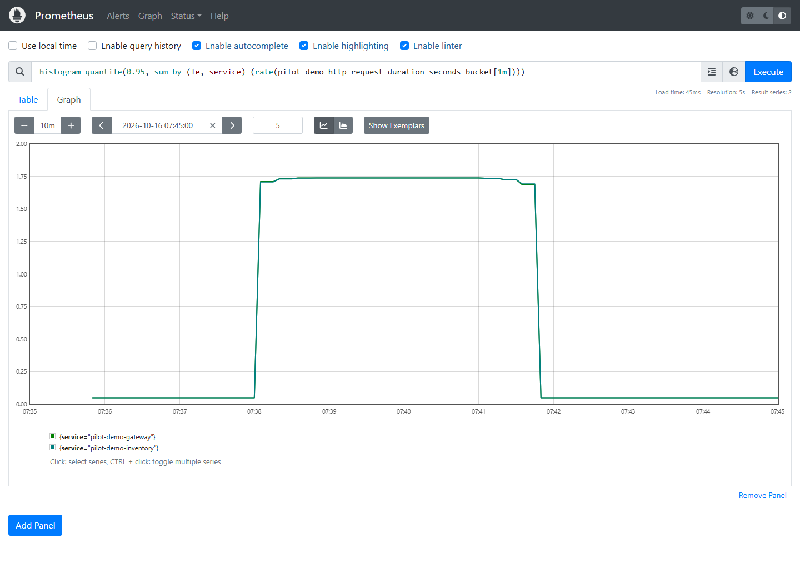
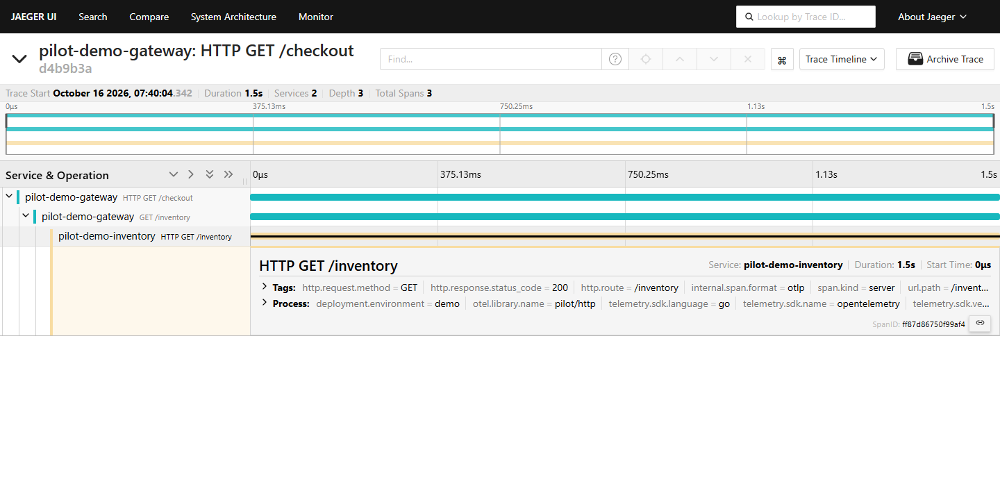
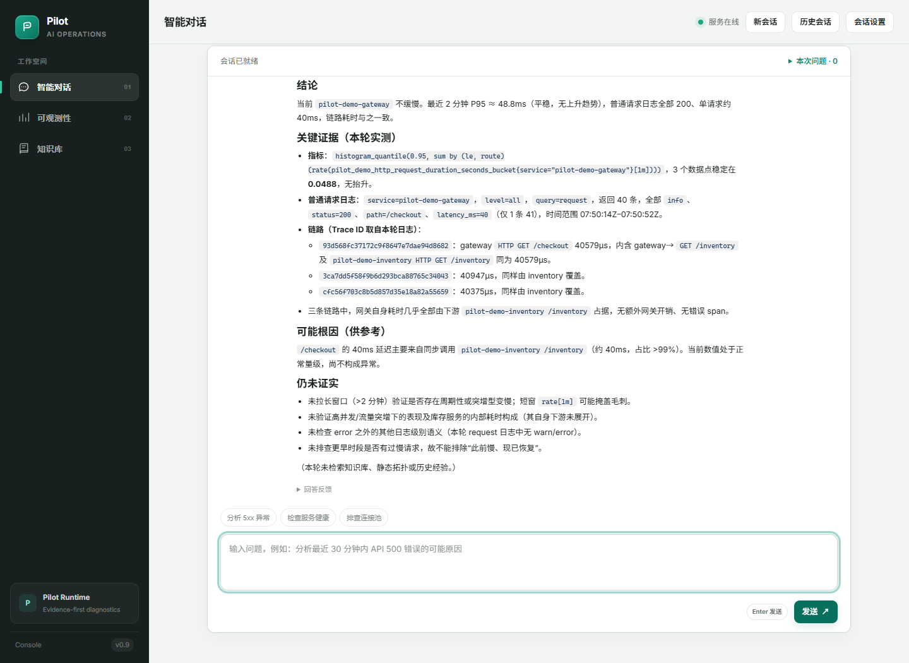

# Pilot 静态演示与证据

这些截图取自 2026-10-16 的本地运行。网关真实调用 inventory，操作脚本临时增加下游处理等待，随后恢复。日志、指标与 Trace 来自这些真实请求；Agent 没有收到延迟开关状态或预设根因答案。该场景用于演示调查能力，不代表生产事故或模型准确率评测。

## 1. Agent 调查与工具调用

用户描述网关响应变慢，Agent 查询指标、日志和链路。页面展开真实运行的执行步骤及 `query_traces` 参数，保留实际 Trace ID；历史内容通过已有 Run 事件回放展示，没有修改工具结果或模型回答。



图中的 `4 个步骤` 是界面合并后的步骤类别，不是工具调用次数；这次运行实际调用工具 8 次。问题中要求“不超过 6 次”属于提示约束，当前没有硬性执行该上限。

## 2. 指标显示正常、变慢、恢复

Prometheus 查询原始历史数据，窗口为 **2026-10-16 07:35–07:45 UTC（北京时间 15:35–15:45）**。网关和下游的延迟曲线基本重合。



截图使用的查询：

```promql
histogram_quantile(0.95, sum by (le, service) (
  rate(pilot_demo_http_request_duration_seconds_bucket[1m])
))
```

| 阶段 | 验收采样请求耗时 | P95 |
| --- | --- | --- |
| 正常 | 41.021 ms | 48.75 ms |
| 变慢 | 1500.088 ms | 1737.5 ms |
| 恢复 | 40.822 ms | 48.75 ms |

请求耗时是各阶段验收采样的真实 Trace 数据；P95 是直方图桶内估算，不能当成同一个请求的精确耗时。重启期间开始处短暂缺样保持原样。短场景采用 `rate[1m]`；更长的平滑窗口可能让恢复后的 P95 暂时仍偏高。

## 3. 用同一 Trace ID 查看下游耗时

Agent 调用参数里的 `d4b9b3a9ee0e59d4b942babf38466ad3` 可以在 Jaeger 找到同一条慢请求。它发生于 **07:40:04 UTC**，包含两个服务、三个 Span：

```text
pilot-demo-gateway   HTTP GET /checkout
└─ pilot-demo-gateway   GET /inventory
   └─ pilot-demo-inventory   HTTP GET /inventory
```



链路支持“耗时集中在 inventory 调用覆盖的阶段”。父子 Span 的耗时不能相加；缺少下游内部细分 Span 时，不能据此证明数据库慢、CPU 饱和或网络拥塞。表格里的慢请求是同阶段另一条验收样本，与这里的展示请求不同。

## 4. 恢复后重新取证

恢复阶段另开一个隔离会话，让 Agent 获取新日志、指标和 Trace。截图保留实际输出，包括当前 P95、请求耗时、引用 ID 和未验证范围，没有将历史慢请求结果当作新请求证据。



该轮自动验收确认三个工具均成功执行、指标非空、查询的 Trace ID 来自本轮先前返回的日志，并出现在最终回答中。这些检查不等于证明回答中每句话都正确。

## 验证范围与已知限制

- 正常、变慢、恢复三阶段均验证了 ES 日志、Prometheus 样本和 Jaeger 的三段父子 Span。恢复诊断本轮也通过了上述工具证据检查。
- 变慢阶段的模型曾采用较长的指标平滑窗口，并作出“没有正常基线”的判断；独立 Prometheus 图实际上能看到正常基线。因此第一张图展示工具调用过程，不将该轮全部自然语言结论列为验收通过。这也是保留原始观测图的原因。
- 模型可能重复查询，提示中的调用次数和回答字数不是硬限制。步骤显示的 `0.0 秒` 是前端小数位舍入，不代表没有调用后端。
- Prometheus 与 Jaeger 截图统一使用 UTC；工具结果中的格式化时间可能使用服务端北京时间。历史回放的消息时间也不能替代观测事件时间，应以日志、指标与 Span 的时间为准。
- 演示使用独立 `pilot_demo` 数据库、`pilot_demo_logs` 索引及专用指标前缀。验收时原 `pilot` 的 Run 数仍为 1、经验数为 0，演示经验数为 0；没有将演示结论发布到日常经验库。

## 复现与文件范围

按照[真实 HTTP 慢下游演示](observability-demo.md)启动、执行正常/变慢/恢复并验证。截图是某次真实运行的快照；重新运行会得到新的时间和 Trace ID，Jaeger 内存数据也不会随图片一起保留。

公开素材仅为本页和 `docs/images/demo/` 中的四张 PNG。Cookie、本地配置、密钥、完整 SSE、请求记录及原始验收 JSON 保留在被忽略的 `artifacts/observability-demo/`，不随截图提交。
